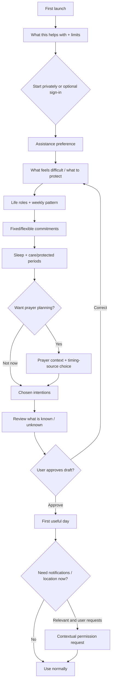

# Islamic Life Companion — Complete Experience Blueprint v1.0 (with v1.1 product policy)

**Date:** 24 October 2026  
**Status:** Proposed product specification, ready for wireframing and expert/usability review; **not** a finished or religiously certified application.  
**Basis:** The founder's five fixed decisions; `Islamic_Life_Model_Consolidated_Foundation_v1.md`; the five uploaded desk-research texts; official human-interface and accessibility guidance.  
**Audience:** Founder, product designer, UX researcher, Islamic scholarly reviewers, content reviewers, product engineers and accessibility testers.  
**Scope:** Full user experience from first launch through everyday, weekly, seasonal and exceptional use, including navigation, screen inventory, interaction contracts, visual language, and testable behavior. No choice of programming language, backend, commercial model or implementation architecture.

**Implementation status after independent review:** This is a **candidate experience catalog**, not the release backlog; no native OS notification/backup implementation, user study or qualified Islamic sign-off exists. The linked v0.1 research slice and mobile contract state the additional verification required.

> **CURRENT FOUNDER DIRECTION / v1.1 OVERRIDE (24 October 2026):** [Free, local-first, zero-open policy](LOCAL_FIRST_ZERO_OPEN_POLICY_v1.1.md). The first release must be useful without a paid AI service, chatbot, subscription, account, ongoing backend connection or daily app check-in. Core experience is offline-first with optional on-device notifications; a successful ordinary day can involve **zero launches**. Where this earlier v1.0 specification implies AI-dependent onboarding, automatic background tracking, engagement reminders or a required dashboard visit, **the linked v1.1 policy takes precedence**. Screen IDs remain unchanged.

> **Definition:** A rights-aware, context-sensitive, autonomy-preserving companion that helps Muslims plan and carry out responsibilities, preserve rest and family rights, and maintain self-chosen practices. It must never behave like a moral scoring machine or a religious authority.

## Reading this specification

- **LOCKED:** chosen by the founder or inherited from the adopted conceptual foundation.
- **PROPOSED:** our concrete UX decision, changeable after review and tests.
- **SCHOLAR GATE:** religious content/rule must be approved by appropriate qualified reviewers before release.
- **TEST GATE:** usable in concept but requires evidence from representative people before claiming benefit.
- Screen IDs remain stable across design iterations. `S` = screen, `M` = short-lived modal/bottom sheet, `X` = system or exception state.
- The catalog includes standalone views, full-screen flows, overlays, secondary settings and special states. Not every item is a bottom navigation destination.
- Example copy is a **design hypothesis**. Words such as *obligatory*, *recommended*, *missed*, *concession*, *Iqamah* and *valid time* require religious-content review where used consequentially.

---

# PART I — PRODUCT IDENTITY AND CORE LOGIC

## 1. Unchanging decisions

1. **Universal life model, individualized routine.** Design for students, workers, owners, carers, parents, women, men, disabled people, travelers, retirees and people with irregular schedules. A universal *framework* must not require a universal timetable.
2. **Daily-life organization first.** Whole-life ethical and character development is a long-range expansion, not compulsory v1 functionality.
3. **Shared Islamic principles first.** Where meaningful fiqh differences arise, disclose, use reviewed named guidance if selected, or abstain; don't guess from nationality, location, gender or title.
4. **User-selectable involvement.** On-demand, gentle, proactive; each involves different assistance frequency, **not** different religious rules.
5. **Success outside the phone.** Better fulfillment of chosen responsibilities, fewer preventable conflicts, sustainable sleep and family time, less unwanted distraction, autonomy and no increase in guilt.

## 2. The user's job-to-be-done

> “Understand what my days actually demand, help me plan around my religious and personal responsibilities, give me a useful option when something clashes, and leave me alone when I don't need help.”

Secondary jobs: “Help me arrive prepared for a congregation I want to attend”; “Let me maintain a modest Qur'an practice”; “Stop optional habits from crowding out sleep”; “Notice a changed routine without inventing facts”; “Give me a clear answer about what you know and don't know.”

## 3. What it is not

Not a fatwa engine; prayer compliance tracker; streak-based gamified habit app; Qur'an reader replacement; mosque authority; social network; parental/spousal surveillance tool; mandatory schedule; compulsive daily checklist; automated adjudicator of religious concessions; AI chatbot dressed as a life planner. It may deep-link to trusted content or offer practical bookmarks where the person chooses.

## 4. Conceptual entities — what the experience represents

| Object | What it means | Visible to user as | Cannot be mistaken for |
|---|---|---|---|
| **Right/responsibility** | A legitimate claim to protect | “Family care,” “Required work,” “Prayer window” | Generic task points or spiritual worth |
| **Commitment** | Time-bound or recurring engagement; may involve others | Calendar block with *fixed/flexible/uncertain* | A religious ruling |
| **Intention** | Freely chosen activity to support | “Read a little Qur'an,” “Walk regularly” | A new obligation or debt |
| **Opportunity** | A feasible occasion to act | “Possible 15-minute window” | Guaranteed availability |
| **Capacity boundary** | Need for rest, mobility, care, safety | “Protected recovery” | Medical diagnosis |
| **Prayer window** | A source- and method-specific religious timing | Start, end, source/method where configured | Mosque's actual Iqamah |
| **Congregation event** | Mosque-specific start on a certain date | “Iqamah reported at …, checked …” | Universally verified fact |
| **Source record** | Who asserted a fact, when, and with what certainty | “You told me” / “Published by mosque” / “Estimated” | Invisible truth |
| **Assistance permission** | Whether app may initiate contact | “Quiet” / “Gentle” / “Proactive” + selected alerts | Authority to decide the person's religion |
| **Suggestion** | Proposed option with reason and consequence | Card: “Why this?” / “Use” / “Not now” | Automatically approved plan change |
| **Correction** | User changes known fact, preference or decision | “This isn't accurate” | Negative moral feedback |

### Confidence vocabulary

- **Confirmed by you:** explicitly supplied or re-confirmed by the person.
- **Verified source:** directly attributable, current external source, with applicable date and category.
- **Estimated:** a calculated value with basis stated, such as travel allowance.
- **Suggested:** app-generated preference or option needing consent.
- **Unknown:** not collected, out of date, contradictory, or not safely inferred.
- **Review required:** normative/religious applicability cannot be safely resolved from approved content.

## 5. Universal intervention protocol

**Trigger → relevance → facts → permissible boundary → feasibility → interruption cost → response → feedback.**

1. Only start if a person requests help, an opted-in reminder becomes due, or a permitted context reveals a genuinely relevant conflict.
2. Determine which commitments and people are affected; identify facts, assumptions and missing information.
3. Check a religious rule **only** if verified and applicable. Otherwise offer neutral timing data, ask for a chosen scholarly approach, or refer/abstain. Never manufacture exemptions.
4. Check sleep/recovery, dependent care, travel safety, accessibility, interruption and fixed commitments.
5. Prefer alternatives that preserve both rights or commitments. When not feasible, show valid choices and their implications without moral judgment.
6. Possible outcomes: **inform / suggest / ask / request approval / preserve plan / abstain / refer / silent**.
7. Make no consequential change without approval; show undo for reversible changes.
8. Learn only from explicit corrections or narrow, permissioned signals. Dismissal is not proof of moral failure.

### Sample rule, written as product behavior

**When** a selected congregation is approaching **and** the user requested preparation alerts **and** a current Iqamah source and route estimate are available **and** no suppressed context is active, **then** offer one departure cue. **Else** show the best known information only when requested, flag stale/unverified data, or remain silent. The app must not label the obligatory prayer missed merely because a congregation event passed.

## 6. Navigation architecture

**Phone — four top-level areas:**

1. **Today:** optional on-demand view of current state, next meaningful anchor, upcoming commitments and restrained contextual help. **Opening Today daily is not required for a successful experience.**
2. **Plan:** day/week schedule, commitments, conflict alternatives, protected time and review.
3. **Intentions:** optional practices and goals; support is sustainable, flexible and user-authored.
4. **You:** life profile, assistance boundaries, prayer timing source, permissions, privacy, evidence policy and accessibility.

**Utility entry points, not permanent tabs:** Mosque opportunities via prayer detail; Qur'an last-place marker via an intention; Focus/protected-time controls via Today/Intentions; Travel/Ramadan adjustments via contextual banner or You; Help/source explanation from any recommendation.

**Global entry points:** a contextual **“Adjust today”** action; **“Ask for help”** for a current planning problem; optional search of one's own commitments (not an open-ended fatwa chatbot). Do not show a permanent conversational input if there is no actual decision to make.

**Navigation rules:** tapping a tab preserves the previous scroll/context; overlays return to origin; deep links reconstruct a safe destination when signed out or unconfigured; screen content cannot disappear solely because permission was denied. Tablets and desktop/web use a rail/sidebar and optional side-by-side Today + timeline. Accessible back, no gesture-only navigation.

### 6.1 Primary interaction is life outside the app (v1.1)

The product's default delivery surfaces are an **approved personal routine**, **quiet normal operation**, and (only when explicitly enabled) **short, useful local notifications**. A dashboard is a fallback and exploration surface, **not** the center of a daily attention loop. A single selected cue should, where supported by the OS, communicate what matters without requiring navigation.

- **No mandatory daily opening:** never schedule a routine "check in" or "come back" prompt for engagement. An empty home view, quiet week or zero-open day is acceptable.
- **No always-on agent:** do not promise continuous detection of personal behavior, phone usage, location or schedule changes. In v1, only user-declared changes or supported/consented inputs can modify the plan.
- **No paid AI requirement:** guided questions, structured constraints, conflict alternatives and locally scheduled reminders must work without model inference or network access.
- **No cloud-first registration:** the user may start privately and maintain the working core entirely on-device. Optional backup/sync needs a separate review.
- **No surprise interruptions:** reminders are opt-in by category, with appropriate quiet hours, freshness/expiry checks and a manual alternative.
- **No invented religious fact:** offline or stale Iqamah information must be labeled, not treated as guaranteed, and may suppress a departure cue.

The detailed operational rules, acceptance scenarios **ZO-01–ZO-08**, scope limits, privacy guardrails and platform caveats live in [`LOCAL_FIRST_ZERO_OPEN_POLICY_v1.1.md`](LOCAL_FIRST_ZERO_OPEN_POLICY_v1.1.md). It is the controlling product decision document for v1, without renumbering the original 106 screen/state entries or 30 journeys.

### 6.2 Trusted mosque data as an optional connected layer (future module)

The founder has proposed a community contribution model with mosque records and authorized Imam/committee/volunteer editors. **Decision:** Include this in the roadmap as a verified mosque-information network, not as a fifth tab or an Imam social network. **Separate the mosque's institutional identity, operational publishing permissions and scholarly qualifications.**

The [Mosque & Community Network Proposal v0.1](MOSQUE_COMMUNITY_NETWORK_PROPOSAL_v0.1.md) details verification, authority transfers, legitimate data sources, publication/versioning, subscriber privacy, Iqamah changes, communication categories, safeguarding, failure states and pilot acceptance gates. It is **proposed future scope**, not evidence that mosque adoption or community moderation is feasible.

- Existing first-release `S61–S70` may show sourced or user-confirmed mosque information with a freshness label. Do not label a user entry "official" or create unverified departure promises.
- A later verified organization profile can publish mosque-specific Iqamah and announcements. People choose sources and optional notification categories; their personal lives remain local and invisible to mosque administrators.
- An Imam may be one authorized editor, but verification of mosque administration is **not** verification of qualifications to issue religious guidance.
- Community groups, direct messaging and personalized fatwa services are excluded from v1 and the initial mosque pilot.
- Existing mosque-management tools are potential **authorized sources**; do not use private/restricted APIs or force duplicate timetable maintenance when approved subscriptions/imports are available.
- The background-first goal still applies: mosque content is actionable information, not a feed designed to increase app opens.

### 6.3 The actual research prototype is a selected slice, not the full catalog

The historical **Core/Bounded/Scholar-gated/Later** labels in the 106-entry screen catalogue are *original specification priorities*, **not** a committed engineering backlog. An external review found **79 Core, 17 Bounded, 7 Scholar-gated and 3 Later** catalog entries. Implementing all Core-labelled views before testing user need is not justified. See [Research MVP & Validation Plan v0.1](../research/RESEARCH_MVP_VALIDATION_PLAN_v0.1.md) for a narrow vertical slice centered on one real conflict, consent, source transparency, offline persistence and reversible choices. Preserve screen IDs; reclassify actual implementation scope based on observed tasks, not a fixed page count.

The [Mobile Reliability, Consent & Local-Data Contract](../architecture/MOBILE_RELIABILITY_PRIVACY_CONTRACT_v0.1.md) governs any implementation assertion regarding notifications, source freshness, backup, denial and reporting. Its technical assertions are provisional until tested on actual supported devices.

## 7. Functional scope by release

| Priority | Included functionality | Deferral or constraint |
|---|---|---|
| **Core v1 experience** | Guided adaptive onboarding (no AI required); draft life model; Today; day/week planning; fixed/flexible commitments; user-selected assistance; optional intentions; prayer windows when configured; sleep/protected time; conflict explanation; corrections; weekly review; privacy controls; baseline offline display | Must work without account, continuous location or phone-usage access |
| **Bounded specialized v1** | Mosque lookup and sourced Iqamah *where data truly exists*; preparation cues; Qur'an-position bookmark; optional digital-focus sessions; Friday/shift/travel/Ramadan profile prompts | No invented mosque times, fiqh rulings or coercive blocking |
| **Later with evidence** | Calendar import/writeback; richer mosque verification; learned suggestions; statistical personalization; multi-device sync; deeper accessibility paths | Permissioned and independently tested |
| **Future mosque network pilot (P1, independently gated)** | Verified mosque institution records; delegated timetable editors; sourced/dated Iqamah & Jumu'ah; opt-in selected alerts; dispute/correction process | Separate connected service; no personal data sharing; no required accounts for ordinary users; do not ship before verification/cost/live pilot gates |
| **Later with scholarly and user evidence** | Detailed character education, complex family mediation, finances/zakat, fasting jurisprudence, community programs, tailored religious learning | Separate content and safety review; don't quietly add to the daily planner |

---

# PART II — LOOK, FEEL AND INTERACTION LANGUAGE

## 8. Visual vision

**Design character:** quiet, editorial, humane, premium, spiritually respectful, unmistakably useful. Think beautifully composed personal planner rather than “more Islamic productivity.” The app should feel calm at 5 AM and still useful during a hectic afternoon.

**Proposed design tokens** (all candidate values; require contrast and usability testing):

| Purpose | Light theme | Dark theme | Usage |
|---|---|---|---|
| Canvas | `#F7F6F2` warm ivory | `#121916` deep charcoal-green | Main background |
| Surface | `#FFFFFF` | `#1C2722` | Cards and editors |
| Primary ink | `#17241E` | `#F2F3EF` | Headlines and essential content |
| Secondary ink | `#54635A` | `#B6C4B9` | Explanations and metadata |
| Core accent | `#235E48` | `#78B49B` | Primary actions and active nav |
| Accent detail | `#B58B52` muted brass | `#C6A878` | Small indicators; never information-only |
| Calm status | `#DDECE1` | `#243D32` | Opportunity/selected state |
| Caution status | `#F5E7D4` | `#4C3827` | “Not verified,” “needs confirmation” |
| Error status | `#9E453B` | `#E59D94` | Actual errors, not skipped worship |

**Typography:** highly legible contemporary sans-serif for interface; choose full-quality Arabic/Urdu glyph coverage and correct shaping. Use Arabic script sparingly and meaningfully (e.g., prayer names), never as ornamental filler. Avoid calligraphy as a body font. Support localization and right-to-left layouts in navigation, date order, icons that convey direction, reading order, input and accessibility labels. Dynamic type must not truncate prayer dates or actions.

**Spatial rhythm:** 8-point grid, generous whitespace, one primary action per screen, clear contextual headings, small number of competing cards, 16–24dp page margins on phones, 12–16dp card radii, restrained dividers, 44–48dp practical touch targets. Use native accessibility sizing. No forced animations, fake progress rings or endless feeds.

**Motion:** 120–240ms gentle transitions to clarify change, not to create ritual spectacle. Respect reduced-motion settings; no fireworks/confetti when worship is marked complete. Haptics only for intentional confirmation, not guilt-inducing streak celebrations.

**Photos/illustration:** minimal. Use elegant abstract geometry, subtle natural light, and useful iconography; avoid faces as decorative default, stock mosque collage, emoji overload, or visually loud religious clichés. The person’s commitments are visually dominant.

**Accessibility:** large text, screen readers, semantic headings, sufficient contrast, non-color status labels, large targets, keyboard support on larger form factors, offline fallback, no time-limited forms, RTL testing, clear voice-over pronunciation and meaningful labels. Aim at WCAG 2.2 AA where applicable alongside mobile accessibility expectations. Reference: https://www.w3.org/TR/wcag/ .

**Official UI references:** Apple HIG onboarding and tab bars encourage focused onboarding and fewer persistent navigation destinations (https://developer.apple.com/design/human-interface-guidelines/onboarding and /tab-bars). Android recommends adaptive navigation for larger windows (https://developer.android.com/design/ui/mobile/guides/layout-and-content/layout-and-nav-patterns). These are *interaction* guidelines, not evidence for religious efficacy.

## 9. The four central screen patterns

### 9.1 Today — “What matters now?”

```text
┌────────────────────────────────────┐
│ Sat, 24 Oct          ◌ Quiet mode  │
│ Good evening                       │
│                                    │
│ NEXT MEANINGFUL ANCHOR             │
│ Isha prayer window                 │
│ [Times & source]     [Plan around] │
│                                    │
│ YOUR EVENING                       │
│ 6:30  Family dinner  • Protected   │
│ 8:10  Prepare for tomorrow         │
│                                    │
│ OPTIONAL IF USEFUL                 │
│ You wanted a short reading window  │
│ [See options]        [Not now]     │
│                                    │
│ [Adjust today]      [Ask for help] │
│                                    │
│ Today   Plan   Intentions    You   │
└────────────────────────────────────┘
```

**Composition:** date + mode; one “next” card; next 2–4 commitments; at most one current optional suggestion in the visible viewport; immediate tools in a low-visual-weight row. If there is no valid suggestion, remove its card rather than fill the space with inspiration or upsells.

### 9.2 Plan — “What is realistic?”

```text
┌────────────────────────────────────┐
│ Plan                [Day] [Week]   │
│ Sat 24  Sun 25  Mon 26  ...        │
│                                    │
│ Prayer windows · source visible   │
│                                    │
│ 06:00 ┊  Recovery / sleep         │
│ 09:00 ┊  Work • fixed             │
│ 12:00 ┆  Prayer window            │
│ 13:00 ┊  Meeting • fixed          │
│ 15:00 ┊  Open / flexible          │
│ 17:00 ┊  Family care • protected  │
│                                    │
│ [Add commitment] [Check conflicts]│
│                                    │
│ Today   Plan   Intentions    You   │
└────────────────────────────────────┘
```

**Composition:** time-axis is optional view, not a packed default. Show window spans distinct from point-in-time events. Fixed/protected/estimated indicators use labels and patterns, not color alone. Empty intervals must look legitimate, not like failed utilization.

### 9.3 Intentions — “What do you want to sustain?”

```text
┌────────────────────────────────────┐
│ Intentions               [+ Add]   │
│ What would you like support with?  │
│                                    │
│ Qur'an                             │
│ Continue from last saved place     │
│ [Open intention]                   │
│                                    │
│ Walking                            │
│ Flexible • a few times a week      │
│ [Find an opportunity]              │
│                                    │
│ Phone-free family time             │
│ Currently paused                   │
│ [Resume when ready]                │
│                                    │
│ No streak, rank, or piety score.   │
│ Today   Plan   Intentions    You   │
└────────────────────────────────────┘
```

### 9.4 You — “What does the app understand about me?”

```text
┌────────────────────────────────────┐
│ You                                 │
│ My week             [Review]       │
│ Assistance style    Gentle         │
│ Prayer guidance     Needs setup    │
│ Protected time      3 periods      │
│ Intentions          2 active       │
│                                    │
│ Privacy and permissions            │
│ What you told me / what I assumed  │
│ Sources and religious boundaries   │
│ Accessibility / language / theme   │
│ Export / reset / delete            │
│                                    │
│ Today   Plan   Intentions    You   │
└────────────────────────────────────┘
```

## 10. Shared interaction patterns

**Context card:** Title; practical reason; source/confidence; one primary action; “Not now”; “Why this?”; never guilt copy.  
**Fixed vs flexible event:** explicit toggle with examples; default unclassified events to “do not move without asking.”  
**Proposal confirmation:** “Here is what changes / what stays / what I couldn't verify.” One clear approve action plus cancel.  
**Evidence drawer:** “Source / last checked / applies to / what this does not establish / report a problem.”  
**Pause / reduce support:** available from every unsolicited suggestion or You screen; never require lengthy explanation.  
**Empty state:** explains legitimate absence, offers optional path (“Your evening is free” rather than “No achievements yet”).  
**Unknown state:** plain-language uncertainty; choose information-only path; don't substitute fake certainty.  
**System status:** never block the whole app for optional location/notifications/calendar access.  
**Religious copy:** precise and restrained; no fatwa-sounding advice generated from a planner inference.

---
# PART III — ONBOARDING AS THE FIRST VALUE EXPERIENCE

## 11. Promise of first-use experience

The visitor should experience a useful *draft* day without needing a legal name, age, phone number, continuous GPS, family identity, employer name, calendar login, or proof of prayer attendance. Allow **Start privately** and a later optional account/sync path. The main path aims for a short, intelligible conversation; “Tell me more” adds depth for willing participants. This is an interaction proposal, **not** a proven optimal onboarding length.

**Framing copy:** “Tell me what your days are like. I’ll help you see what might fit. You can skip anything, and you can change my understanding whenever you want.”

### Onboarding path, conceptually



**No sign-in trap:** no account is required to see a working local draft. “I only want prayer planning” and “I only want general life balance” both lead somewhere useful. An opt-out from prayer assistance does not invite religious judgment or repeated nagging.

## 12. Eight core question areas with consequence mapping

| Area | Plain-language prompt | Answer shapes | What changes **immediately** | Skip/unknown behavior |
|---|---|---|---|---|
| **Q1 Assistance** | “How involved should I be?” | On demand / Gentle / Proactive | Eligible unsolicited response types and opt-in reminder controls | On-demand, no proactive prompts |
| **Q2 Priorities** | “What feels hardest to balance lately?” | Up to 3: prayer logistics, work/study, sleep, family/care, Qur'an/learning, movement, phone distraction, just organize | Which contextual paths are offered first; never religious rank | Neutral draft with no improvement target |
| **Q3 Roles and variability** | “Which describes your week?” | Student / fixed hours / rotating shifts / self-employed or variable / caregiver / mixed / other; fixed vs varying | Clock blocks vs roster vs flexible windows | Variable week; don't invent recurring pattern |
| **Q4 Real commitments** | “What parts of your week are already spoken for?” | Simple events, recurring days, rough hours, fixed/flexible/not sure | Protect and place known commitments; detect possible conflict | Only known facts; narrow suggestions |
| **Q5 Sleep and recovery** | “When do you usually need sleep or recovery?” | Approximate period / changes with shift / unpredictable / skip | Don't fit optional work into protected recovery | No assumptions about capacity; ask later if needed |
| **Q6 People and protected time** | “Is there time you want me to protect?” | Family/care, commute, recreation, personal quiet, recurring commitments, none, prefer not to say | Creates personal boundaries; suppresses optional prompts | No invented duties or family status |
| **Q7 Prayer context (conditional)** | “Would you like help planning around prayer, and what times do you follow?” | Prayer windows, preferred mosque/congregation, local timetable, known method, not sure, none for now | Enables appropriate timing options; source-specific warnings | No religiously consequential defaults; neutral setup state |
| **Q8 Chosen intentions** | “Anything optional you'd like to make room for?” | Qur'an, learning, exercise, digital focus, community, none; flexible amount | Creates editable voluntary intention, not a compulsory block | No voluntary suggestions |

**Suggested order:** Assistance → priorities → weekly pattern → commitments → protected time/sleep → optional prayer configuration → intentions → review. For night-shift/caregiving users, sleep and protected time come before proposed devotional opportunities. Sequence may be varied by user testing.

### Conditional question rules

- **Student:** “Do classes vary by weekday or academic term?” Add exam/term variation if chosen.
- **Fixed work:** “What hours are usually fixed, and is there a commute?” Ask the minimum accurate time band.
- **Shift/on-call:** “Do you receive a roster, repeat a shift cycle, or get short notice?” No 9–5 assumptions; day view may start at wake.
- **Caregiving:** “Which periods can unexpectedly need your attention?” No names, diagnoses or mandatory disclosure.
- **Prayer + mosque intent:** “Do you already use a particular mosque? Want a congregation-time check?” Do not request location before the person initiates a location-dependent action.
- **Prayer + unclear timing method:** offer “I follow a local mosque/institution timetable,” “I know my method,” and “I’m unsure”; show limitations; do **not** silently choose a contested legal position.
- **Qur'an:** “Would you prefer a time-based intention, reading amount, or just a bookmark?” All optional, editable. Never imply a required quantity.
- **Phone distraction:** “Which period do you want to protect?” Avoid requesting full device history; device controls are separately permissioned and platform-dependent.
- **Travel:** ask about trip context only when the person sets travel mode; do not manufacture a travel prayer concession.
- **Personal menstrual/postpartum accommodation:** entirely optional, privacy-sensitive; let the person self-adjust prayer display without mandatory tracking or guessed status; show reviewed informational caveats.
- **Accessibility:** ask functional preferences (“step-free route,” “larger text,” “cannot walk far”), not a diagnosis.

### Asking rules

Every question has a one-sentence **reason** and **Skip** except essential choice “How much help?” which can default to Quiet. **Prefer not to say** is explicit for sensitive questions. Never require account creation to complete. Previous answers remain editable. Show one question per focused view, not a dense registration form; provide a “Basic / More detail” route rather than twenty uninterrupted screens.

## 13. The first draft is a negotiation, not a command

At end of onboarding display:

1. **What you told me:** e.g., “Classes 9–2 on weekdays,” “Want gentle help,” “Family dinner is protected.”
2. **What I can use if configured:** e.g., “Prayer windows follow your selected source,” “I don't have a confirmed Iqamah at your mosque.”
3. **What I don't know:** e.g., “Travel time,” “Friday pattern,” “Sleep varies.”
4. **A suggested day:** prayer windows where available + actual commitments + protected recovery + *zero or a few* chosen voluntary activities.
5. **Consent:** “Use this draft” vs “Correct something”; consequential routines aren't activated just by tapping through onboarding.

**Important**: The first useful output must have a valid “nothing new added” version for someone who only wants clarity and no intervention.

## 14. Identity, notifications and location choices

- **Account:** “Continue privately” primary; optional sign-in/backup after seeing the plan. If data stays local, clearly state device-loss risk until backup is enabled. If the app cannot implement private-mode data persistence, this design is a requirement to reconsider transparently, not pretend it works.
- **Notifications:** ask at the first moment the person enables a relevant alert, with explanation and preview. Denial preserves on-screen functionality. Official iOS guidance favors contextual permission requests: https://developer.apple.com/documentation/UserNotifications/asking-permission-to-use-notifications.
- **Location:** no precise location on launch. Ask once for a deliberate nearby-mosque or local-time use; permit manual city/area/mosque selection; honor one-time access vs ongoing permission.
- **Calendar:** optional; never read or alter outside commitments without explicit permission and appropriate confirmation. Manually entered events work fully.
- **Phone-use permissions:** optional later, with clear scope, platform-dependent feasibility and safe alternatives if unavailable.

---

# PART IV — EVERY SCREEN AND EVERY STATE

## 15. Naming conventions

**Full screen** = part of navigation stack with visible back/context; **sheet** = focused, reversible task; **system state** = permission/offline/uncertainty route, often rendered inside an affected screen. Every screen has at minimum: title, context, clear primary action, escape/back, explanation of unknowns, proper empty/loading/error handling, keyboard and screen-reader behavior.

The **screen register** is the exhaustive v1 information architecture. A spreadsheet-like CSV companion contains the same catalog for production tracking. The detailed specifications immediately following describe behavior of the most consequential experiences and reusable patterns so that catalog rows aren't just labels.

### Entry screens

| ID / view | What is displayed | Primary action and next screen | Key states / constraint |
|---|---|---|---|
| **S00 — Launch & resume** (System landing) | App mark; local-resume/restore state; no marketing animation | Resume last safe destination; → S25 or S01 | Loading; offline; corrupted local profile; **Core** |
| **S01 — Welcome and promise** (Full screen) | Human promise; privacy note; “not a religious authority” | Start privately; → S03 | First use; returning visitor; **Core** |
| **S02 — How this works** (Full screen) | Understand; plan; support; stay quiet with concise illustration | Continue; → S03 | Simple copy; larger text; **Core** |
| **S03 — Start privately or sign in** (Full screen) | Private start; optional backup account; data explanation | Start privately; → S08 | Offline; sign-in not available; **Core** |
| **S04 — Sign in, create or restore** (Full screen) | Methods; account-recovery instructions; privacy scope | Continue with chosen method; → S08 or S25 | Authentication error; offline; **Later** |
| **S05 — Permission rationale at point of use** (Sheet) | Exact benefit; scope; refusal path; preview | Allow this access; → Origin | Denied; restricted; already allowed; **Core** |
| **S06 — Welcome back after absence** (Sheet) | Changes since last use; stale facts; confirm or continue | Review changes; → S25/S76 | Nothing changed; offline; **Core** |
| **S07 — Tour/help overlay** (Sheet) | Four navigation areas and optional dismissible tips | Got it; → Origin | Accessibility tutorial; already seen; **Core** |

### Onboarding screens

| ID / view | What is displayed | Primary action and next screen | Key states / constraint |
|---|---|---|---|
| **S08 — Help level** (Full screen) | On demand; Gentle; Proactive; examples | Choose style; → S09 | Undecided; user changes mind; **Core** |
| **S09 — Current priorities** (Full screen) | Choose up to three tensions or just organize | Continue; → S10 | No priorities; multiple selected; **Core** |
| **S10 — Life roles** (Full screen) | Student; work; owner; care; mix; other | Continue; → S11 | Mixed roles; unclear; **Core** |
| **S11 — Weekly regularity** (Full screen) | Fixed; weekday-variable; shifts; on-call; unpredictable | Continue; → S12 | No stable week; mixed schedule; **Core** |
| **S12 — Commitment sketch** (Full screen) | Add rough recurring fixed/flexible periods; days | Use these commitments; → S13 | No time inputs; overlapping entries; **Core** |
| **S13 — Sleep and recovery** (Full screen) | Broad sleep needs; shift-dependent; unpredictable; skip | Continue; → S14 | Fragmented sleep; unknown; **Core** |
| **S14 — People and protected time** (Full screen) | Care/family/quiet/recreation boundaries; no names needed | Protect selected periods; → S15 | No protected times; uncertain care; **Core** |
| **S15 — Prayer planning interest** (Full screen) | Prayer windows; congregation support; Friday; later; no tracking | Choose prayer support; → S16 or S18 | User opts out; source unknown; **Core** |
| **S16 — Prayer-time source** (Full screen) | Local mosque timetable; known convention; help me choose later; disclaimer | Select source or defer; → S17 or S18 | Method disputed; missing location; **Scholar-gated** |
| **S17 — Congregation preferences** (Full screen) | Specific mosque; nearby search later; desired advance cue | Save preference; → S18 | Mosque not found; stale Iqamah; **Bounded** |
| **S18 — Optional intentions** (Full screen) | Qur'an; learning; movement; digital focus; none; flexible scale | Keep selected intentions; → S19 | No intentions; conflicting goals; **Core** |
| **S19 — Review personal understanding** (Full screen) | Told me; unknown; assumptions; ability to correct each item | This looks right; → S20 | Contradictory entries; skipped data; **Core** |
| **S20 — First draft day** (Full screen) | Next prayer window if configured; commitments; protected time; few/no optional proposals | Use this draft; → S25 | No commitments; prayer unset; sleep unknown; **Core** |
| **S21 — First useful action** (Sheet) | Short contextual tip: add commitment, view prayer source, protect time | Try action; → Relevant screen | No configured items; **Core** |
| **S22 — Conditional work/study details** (Sheet) | Shift roster type, term schedule, commute band; only if changes plan | Apply detail; → Return to parent | Unpredictable; no roster; **Core** |
| **S23 — Conditional care/access needs** (Sheet) | Fixed vs unpredictable care; mobility needs; no diagnoses | Protect boundary; → Return | Sensitive; unknown; **Core** |
| **S24 — Conditional voluntary goal details** (Sheet) | Frequency/window/continuity preference; no quota requirement | Save intention; → S19 or S52 | No chosen cadence; **Core** |

### Today screens

| ID / view | What is displayed | Primary action and next screen | Key states / constraint |
|---|---|---|---|
| **S25 — Today dashboard** (Top-level tab) | Date; assistance mode; next anchor; 2-4 commitments; optional one suggestion | Adjust today; → S26/S34/S29 | No plan; offline; no suggestion; prayer off; **Core** |
| **S26 — Next anchor detail** (Full screen) | Kind/time or window; what is verified; practical preparation | Show options; → S61/S39 | No applicable data; stale source; **Core** |
| **S27 — Current assistance card** (Sheet) | Reason; tradeoff; confidence; why now | Use this suggestion; → S38 or origin | Expired; low confidence; dismissed; **Core** |
| **S28 — Today at a glance** (Full screen) | Ordered actual + proposed events; protected time; unallocated time | Open selected event; → S35/S41 | Empty; crowded; mixed types; **Core** |
| **S29 — Ask for practical help** (Full screen) | Structured choices: plan prayer; resolve clash; make time; adjust day | Choose problem; → S30/S39/S61 | No permission; unknown topic; **Core** |
| **S30 — Help with this situation** (Full screen) | Only relevant facts; 1-3 realistic choices; nothing/ask | See options; → S39/S38 | Unsolvable; requires scholar; **Core** |
| **S31 — Check-in prompt** (Sheet) | Specific question about actual mismatch, not wellness scoring | Confirm change; → S76 or origin | No evidence; not consented; **Core** |
| **S32 — Gentle focus state** (Full screen) | Chosen protected period; essential contacts caveat; resume time | Finish focus; → S25 | Phone controls unavailable; emergency; **Bounded** |
| **S33 — Notification destination** (Deep-link view) | Exact event context and age of message; no stale CTA | View current options; → S26/S38 | Expired; permission changed; offline; **Core** |

### Plan screens

| ID / view | What is displayed | Primary action and next screen | Key states / constraint |
|---|---|---|---|
| **S34 — Plan landing** (Top-level tab) | Day/week toggle; current scope; one next useful action | Open day or week; → S35/S36 | No events; mixed dates; **Core** |
| **S35 — Day timeline** (Full screen) | Commitments; prayer windows; protected blocks; genuine blank space | Select block; → S41/S37 | DST/timezone; overlapping blocks; **Core** |
| **S36 — Week overview** (Full screen) | Seven-day density without moral score; recurring anchors; optional rest | Select day; → S35/S45 | Variable roster; sparse week; **Core** |
| **S37 — Add commitment** (Sheet) | Title; source; time/window; repeats; fixed/flexible/unknown; affected people abstractly | Save commitment; → S35 or S36 | Overlap; invalid end; unknown duration; **Core** |
| **S38 — Review proposed change** (Sheet) | Before/after; who/what is affected; evidence; undo plan | Approve change; → Origin | Invalidated proposal; time moved; **Core** |
| **S39 — Conflict resolver** (Full screen) | Two or more commitments; applicable boundaries; feasible options | Compare alternatives; → S40 | No feasible alternative; scholar gate; **Core** |
| **S40 — Compare alternatives** (Full screen) | Options with consequence, travel/buffer, source confidence, keep current | Choose option to review; → S38 | Estimated times; two rights cannot rank; **Core** |
| **S41 — Commitment detail** (Full screen) | What/when/why/fixed flag/affected responsibilities | Edit item; → S42/S38 | Recurring series; imported read-only; **Core** |
| **S42 — Edit commitment** (Full screen) | Editable event; series vs occurrence; conflicts preview | Save changes; → S41/S39 | Invalid recurrence; other-party approval; **Core** |
| **S43 — Protected time editor** (Full screen) | Why protected; days/windows; suppression preferences | Save boundary; → S35 | Unpredictable; overlaps obligatory prayer; **Core** |
| **S44 — Recurring pattern editor** (Full screen) | Week templates; shifts; seasonal constraints; effective date | Review change; → S38/S36 | Rotating shift; gap weeks; term ends; **Core** |
| **S45 — Weekly reflection** (Full screen) | What worked; what was hard; preventable conflicts; no scores | Keep/change one thing; → S46/S25 | No data; user absent; Ramadan; **Core** |
| **S46 — Review insights & edits** (Full screen) | Participant-confirmed patterns; proposed simple next-week adjustment | Approve small adjustment; → S38/S36 | No meaningful patterns; **Core** |
| **S47 — Plan change summary** (Sheet) | Applied changes; untouched commitments; source of suggestion; undo | Done; → S25/S35 | Apply failed; partial change; **Core** |

### Intentions screens

| ID / view | What is displayed | Primary action and next screen | Key states / constraint |
|---|---|---|---|
| **S48 — Intentions overview** (Top-level tab) | Voluntary goals; active/paused; no progress score | Open an intention; → S49/S50 | None; all paused; **Core** |
| **S49 — Choose an intention** (Full screen) | Qur'an; movement; learning; connection; phone-free; custom | Continue to shape it; → S50 | No category fits; **Core** |
| **S50 — Intention detail** (Full screen) | Personal reason; flexible size; relevant context; last continuity point | Find opportunity; → S51/S52 | Paused; no opportunity; **Core** |
| **S51 — Edit intention** (Full screen) | Preferred frequency/window; low-energy alternative; no backlog | Save choices; → S50 | Unrealistic target; conflict; **Core** |
| **S52 — Opportunity finder** (Full screen) | Actual possible windows; capacity considerations; no forced fill | Choose one possibility; → S38/S35 | No window; low confidence; **Core** |
| **S53 — Qur'an continuity marker** (Full screen) | Saved surah/ayah or page; last verified position; reading external/own preference | Update place; → S50 | No bookmark; mismatch of mushaf; **Bounded** |
| **S54 — Flexible practice session** (Sheet) | Simple user-controlled session; optional begin/end; no score | Begin / end when ready; → Origin | Interrupted; no duration; **Bounded** |
| **S55 — Intention reflection** (Sheet) | “Was this slot realistic?”; timing/effort preference correction | Change future suggestion; → S51/S25 | No feedback; neutral; **Core** |
| **S56 — Pause or resume intentions** (Sheet) | Pause one/all until manual restart or date; notice no debt | Pause; → Origin | Pause indefinite; **Core** |
| **S57 — Digital wellbeing choice** (Full screen) | What user wants less of; when; alternative activity; no judgments | Choose protected period; → S58 | Platform limitation; privacy refusal; **Bounded** |
| **S58 — Phone-free period setup** (Full screen) | Hours; emergency communication; manual vs device enforcement | Save voluntary boundary; → S32/S43 | Permission denied; emergency exception; **Bounded** |
| **S59 — Movement/recreation intention** (Full screen) | Preferred type; realistic windows; accessibility; no compulsory exercise hour | Save; → S50 | Health limitations; no input; **Bounded** |
| **S60 — Learning/community intention** (Full screen) | Reading/service/knowledge choices; chosen time; no moral ranking | Save; → S50 | Outside app scope; source uncertainty; **Later** |

### Prayer screens

| ID / view | What is displayed | Primary action and next screen | Key states / constraint |
|---|---|---|---|
| **S61 — Prayer detail** (Full screen) | Applicable window; source/method; selected help; congregations if sourced | Find congregation options; → S62/S65 | No method; high latitude; offline; **Scholar-gated** |
| **S62 — Mosque search** (Full screen) | Search by name/place or optional nearby; accessibility filters | Choose mosque; → S63 | No results; denied location; **Bounded** |
| **S63 — Mosque listing result** (Sheet) | Mosque identity; access; known facilities; timings labeled by source | View detail; → S64 | Duplicate names; inaccessible; **Bounded** |
| **S64 — Mosque detail** (Full screen) | Address; verified congregation schedule if available; confidence/date; access notes | Select as preferred; → S65/S66 | Outdated; special Friday/Ramadan schedule; **Bounded** |
| **S65 — Congregation options** (Full screen) | Feasible dated Iqamah options; leave estimates separated; no invented times | Select opportunity; → S69 | All unverified; past event; travel unsafe; **Bounded** |
| **S66 — Timing source & methodology** (Full screen) | Chosen timetable/calculation; published source; scope; recognized differences note | Confirm selection; → S61 | Disputed; unavailable; unknown; **Scholar-gated** |
| **S67 — Travel and accessibility context** (Sheet) | Only functional travel constraints; manual area; route mode; safety | Apply travel preferences; → S65 | No route; wheelchair accessible unknown; **Bounded** |
| **S68 — Prayer-information evidence** (Full screen) | Prayer rule record; reviewer/source; limits; uncertainty and last checked | Close; → Origin | Not reviewed; translation mismatch; **Scholar-gated** |
| **S69 — Prepare to leave** (Sheet) | Specific Iqamah; route allowance; buffer; confidence; requested alert | Enable reminder; → S05 or S25 | Permission blocked; source stale; **Bounded** |
| **S70 — Report timetable correction** (Full screen) | Specific date/source and proposed correction, no private identity required | Copy correction details or open a known external contact; → S64 | No verified receiving service; offline; **future submission requires acknowledged receipt**; **Bounded** |

### You screens

| ID / view | What is displayed | Primary action and next screen | Key states / constraint |
|---|---|---|---|
| **S71 — You overview** (Top-level tab) | Profile summaries; support style; sources; privacy; accessibility; review dates | Review my understanding; → S72/S73/S75 | Minimal profile; missing source; **Core** |
| **S72 — My life model** (Full screen) | Roles; recurring commitments; capacity boundaries; claims vs estimates | Correct a fact; → S73/S76 | Many unknowns; conflicting inputs; **Core** |
| **S73 — Edit life circumstances** (Full screen) | Work/term/roster/care/time boundaries with effective date | Review proposed updates; → S38/S72 | Life transition; data stale; **Core** |
| **S74 — Assistance and quiet hours** (Full screen) | Mode; selected notification categories; interruptions; limits | Save preferences; → S71 | Notifications denied; urgent exception; **Core** |
| **S75 — Prayer preferences and reviews** (Full screen) | Selected timing source/mosque; jurisprudence review gaps; optional prayer visibility | Adjust source; → S66/S68 | Method unset; tradition uncovered; **Scholar-gated** |
| **S76 — Review inferred changes** (Full screen) | Clear differences between stated facts and observed allowed patterns | Confirm or correct; → S72 | No observations; consent revoked; **Core** |
| **S77 — Sources, religious limits and corrections** (Full screen) | What is primary evidence vs planner proposal; status of reviews; corrections | Open a source; → S68/S87 | Sources offline; untranslated; **Core** |
| **S78 — Privacy and data permissions** (Full screen) | Collected categories; purposes; consent grants; location/calendar/device permissions | Change permission; → S79/S80 | Denied; platform restriction; **Core** |
| **S79 — View and export data** (Full screen) | Record types; current device/backup scope; export path | Export my data; → S78 | No data; export failure; **Core** |
| **S80 — Erase, reset or delete** (Full screen) | Differences among pause, erase a category, reset routine, delete account | Confirm chosen deletion; → S01/S71 | Offline; queued cloud deletion; **Core** |
| **S81 — Accessibility, language & appearance** (Full screen) | Text scale; RTL language; motion; contrast; theme; time format | Apply setting; → S71 | Unsupported language; screen reader; **Core** |
| **S82 — Account and backup** (Full screen) | Private-mode status; backup state; account; restore | Enable chosen backup; → S04 | Sync errors; conflicting backup; **Later** |
| **S83 — Change of routine wizard** (Full screen) | Changed job/term/shift/home; effective date; impact preview | Use revised context; → S38/S73 | No effective date; new timezone; **Core** |
| **S84 — Ramadan and seasonal rhythm** (Full screen) | Observed changes; user-chosen sleep/fasting plan; verified timing caveats | Review seasonal draft; → S38/S25 | No Ramadan timetable; personal exemptions; **Bounded** |
| **S85 — Travel mode** (Full screen) | Dates/destination; timezone; prayer-source uncertainty; no automatic fiqh exemption | Start travel context; → S35/S61 | Unknown destination; date crossing; **Bounded** |
| **S86 — Help & contact** (Full screen) | How to correct app; support; accessibility; religious error reporting | Choose help route; → S87 | Offline; no contact available; **Core** |
| **S87 — Report safety/religious concern** (Full screen) | Category; affected message; minimal optional context; privacy notice | Copy limited report / show verified private contact; → S86 | No configured recipient; offline; **never claim submitted until acknowledged**; **Core** |

### Exceptions screens

| ID / view | What is displayed | Primary action and next screen | Key states / constraint |
|---|---|---|---|
| **X88 — Empty day / no profile** (Embedded state) | Unallocated day is allowed; minimal next action | Add or stay empty; → S37 | Fresh user; no goals; **Core** |
| **X89 — Offline / stale content** (Embedded state) | Last verified data separated from current; no invented real-time facts | Use saved information; → Origin | Timestamp absent; route unavailable; **Core** |
| **X90 — Unverified mosque timetable** (Embedded state) | No confirmed Iqamah; exact reason | Use basic timing information; → S61/S70 | Old data; incorrect event type; **Bounded** |
| **X91 — Religious uncertainty / refer** (Embedded state) | What's known; what is disputed; reviewed next step | View verified guidance; → S68 | High latitude; conflicting opinions; **Scholar-gated** |
| **X92 — No feasible option** (Embedded state) | Constraints and how checked; preservation/no-action option | Keep existing plan; → S39 | No prayer option; urgent safety; **Core** |
| **X93 — Plan conflict from unexpected event** (Sheet) | New fact; affected commitments; options; no automatic move | Review options; → S39 | Event cancelled; emergency; **Core** |
| **X94 — Recover from disruption** (Sheet) | Intentions can lapse; protect required/essential tasks; no backlog | Keep rest of day; → S35 | User exhausted; after emergency; **Core** |
| **X95 — System permissions denied** (Embedded state) | What still works; exact manual alternative | Continue manually; → Origin | Restricted account; app background limit; **Core** |
| **X96 — Timezone/DST/midnight crossing** (Full screen state) | Effective zone and date; effect on event windows; ask user to confirm | Review updated times; → S35/S66 | High latitude; clock rollback; **Core** |
| **X97 — Critical safety/religious content pause** (Full screen state) | Affected advice unavailable; safe factual alternatives; transparent reason | Continue without affected guidance; → S25 | Known religious error; privacy breach; **Core** |

### Shared sheets screens

| ID / view | What is displayed | Primary action and next screen | Key states / constraint |
|---|---|---|---|
| **M98 — Why this suggestion?** (Sheet) | Inputs, priority, confidence, burden, approval boundary | Understood; → Origin/S76 | Unknown rationale; conflicting data; **Core** |
| **M99 — Reminder preferences for this event** (Sheet) | Which event; timing buffer; quiet-hours override choice | Save alert; → Origin | Notification denied; **Core** |
| **M100 — Pause all support** (Sheet) | Choose indefinitely/until date; what remains visible | Pause support; → Origin | Active essential user-selected alerts; **Core** |
| **M101 — Delete confirmation** (Sheet) | Exact data/event affected; irreversibility and sync state | Confirm deletion; → Origin | Recurring series; offline; **Core** |
| **M102 — Prayer wording disclaimer** (Sheet) | Religious vs scheduling explanation; reviewed evidence scope | Got it; → Origin | Source not reviewed; **Scholar-gated** |
| **M103 — First-week course correction** (Sheet) | One observed mismatch; user correction invitation | Update my routine; → S76/origin | No consent; few observations; **Core** |
| **M104 — Screen reader help** (Sheet) | Explains time windows, card headings, actions | Close; → S81 | RTL mode; large text; **Core** |
| **M105 — Unsaved changes / leave?** (Sheet) | Specific edit not saved; discard vs continue editing | Keep editing; → Origin | Background interruption; **Core** |

### Screen-count and implementation interpretation

This catalog contains **106 specified views/states**: they are **not** 106 competing tabs or mandatory onboarding steps. They include focused sheets, permission states, exception presentations and specialized routes. Only four views are primary destinations. A team may consolidate some adjacent sheets if usability testing shows the same intent and safety/escape behavior is preserved. The CSV captures entry routes, secondary actions, intended next states and release gates.

## 16. Detailed contracts for consequential screen families

These definitions supplement the full screen register. **Every screen** inherits the shared states in §20; these contracts govern content hierarchy, action semantics and rejection cases across screen families.

### 16.1 First use: S01–S03

**Hierarchy:** single calm statement of purpose → concrete example (“Your day, with prayer, family and rest considered”) → truthful boundary (“You choose; this isn't a religious authority”) → **Start privately** → optional “Sign in / back up later” → privacy details. No permission dialog on open. No testimonials or pressure. **Success:** user can arrive at Q1 offline without supplying personal identity. **Refusal case:** user declines account; no loss of basic planning functionality.

### 16.2 Onboarding question family: S08–S18

**Hierarchy:** simple question → one-sentence “why we ask” → short selectable answer options → “Continue” → Skip / Prefer not to say / Back. State is resumable if interrupted. Conditional follow-ups (S22–S24) are shown only after a parent answer makes them relevant. **Do not** gate progress on religion-sensitive answers. **Success:** each answer updates a visible item in S19, has an explicit decision consequence, and can be reversed.

### 16.3 Profile reflection and draft approval: S19–S20

**Hierarchy:** three headings (“You told me,” “To check,” “Not configured”) → editable facts with one-tap correction → draft timeline → small “What I based this on” explanation → “Use draft”. All inferred data marked **suggested**, never “you usually…”. If no location/timing method is present, there is **no fabricated prayer clock**; offer configuration. If no habits are selected, do not automatically create any. **Success:** user understands what they authorized and can leave all optional goals empty. **Rollback:** return to any answer without losing unrelated inputs.

### 16.4 Today dashboard: S25–S33

**Hierarchy:** today label / subtle help-mode chip → next meaningful anchor (if available) → 2–4 real commitments or protected periods → at most one unsolicited proposal card visible → small “Adjust today” and “Ask for help”. Show nothing that resembles “daily Islamic score”. Time labels show local timezone when materially relevant. Current factual/prayer information should remain accessible in on-demand mode, but no unsanctioned notifications occur. **Success:** person can locate the next commitment and change a conflicting event within two or three actions. **No-data state:** “Nothing is planned here yet. You can leave it open or add a commitment.”

### 16.5 Daily and weekly planning: S34–S36

**Hierarchy:** simple Day/Week switch → clear date range → spans for religious windows (when configured) vs point events for congregations → actual commitments and user-protected periods → accessible action to add/change. Variable-schedule workers see a roster-first week; students may see class-day patterns; caregivers see flexible windows rather than false precision. **Success:** a person can see real conflicts without relying on colors or dense grid interactions. **Constraint:** a prayer window is never represented solely as a rigid 5-minute task chip.

### 16.6 Creating and editing commitments: S37, S41–S44

Input fields: short title, date/time or broad window, recurrence, practical flexibility (**fixed / can move / ask me**), category/purpose, optional protected flag, optional privacy note. Never demand names of dependents or employers. For imported read-only events, show provenance and limits rather than promising to edit them. Recurrence edits distinguish **this occurrence / future occurrences / entire series**. **Success:** a real fixed commitment isn't moved by merely tapping a suggestion. **Validation:** invalid dates/timezone transitions and overlapping commitments get a descriptive warning with save or resolve options as appropriate.

### 16.7 Conflict handling: S39–S40 and S38

**Hierarchy:** “Here's the conflict” → what is certain → what is unclear → 2–3 feasible choices **including keep current** → separate legal/religious caveat if consequential → one confirmed modification at a time. Each alternative states consequences: moved optional item, remaining prayer window, possible inconvenience, uncertainty. **Success:** the chosen option is both practically feasible and within verified boundaries. **Failure:** if no valid alternative exists, show X92; do not invent an option to appear intelligent.

### 16.8 Intentions: S48–S59

**Hierarchy:** named intentions → flexible preference → user-defined “what good enough looks like” (not a religious quota) → find a suitable opportunity → pause/remove at any time. There is no backlog of skipped optional intentions. Qur'an continuity S53 stores a location bookmark when chosen; it doesn't pretend to certify recitation. Focus assistance cannot block emergency communication. **Success:** a missed flexible activity can disappear peacefully; pausing is reversible and never framed as failure.

### 16.9 Prayer and congregation: S61–S70

**Hierarchy:** prayer name and applicable window under user's configured reviewed source → explicit calculation/timetable provenance → separate mosque congregation event(s) with date and source → travel/prepare support *only when sufficiently verified* → access to underlying evidence and uncertainty. Mosque detail must distinguish **Adhan** from **Iqamah**. A missed Iqamah must not become “prayer missed.” On an unverified Iqamah show X90 and an information-only option. On contested applicability show X91, citing scope and referral, not generated personal fatwa. **Success:** user can tell precisely which numbers are calculated, published, user-confirmed and estimated.

### 16.10 Assistance controls: S74 and M99–M100

Controls are **permission categories**, not personality labels alone: opted-in prayer-preparation alerts, conflicts, check-ins, voluntary intention cues, weekly review. **Every unsolicited OS notification category defaults OFF even if Gentle or Proactive is selected.** Assistance style controls the *availability and tone of in-app proposals*, not an implicit permission to send alerts, infer religious/health state, or obtain background location. Each alert category has a separate explicit opt-in, editable quiet hours and dismissal; OS permission is necessary where applicable but never sufficient on its own. Proactive style permits proposals but not automatic consequential plan changes. Quiet hours and “Pause all” always visible. User-requested essential reminders require explicit choice on what pausing affects. **Success:** the app honors silence preferences while allowing selected reminders. A single dismissal does not silently rewrite the user's values.

### 16.11 Reviewing the model: S72–S76 and S83

Every claim is labeled “You told me,” “Imported by permission,” “Published source,” “Suggested from allowed patterns,” or “Unknown.” A single changed job/term/shift starts **effective-date review**, with impact preview before changing patterns. No inferences about prayer attendance, spiritual worth, menstruation or illness. **Success:** user can inspect why suggestions change and revert a mistaken assumption.

### 16.12 Weekly reflection: S45–S46

Three reflective prompts at most, all optional: “What was difficult to fit?”, “Was any suggestion unhelpful?”, “Should next week stay the same or change one thing?” Avoid red/green completion percentages, worship scores, guilt language, comparison to other people and retrospective pressure to disclose private religious acts. **Success:** the user can finish the review with **Keep everything as it is**; review itself must not become another daily duty.

### 16.13 Privacy and deletion: S78–S80

List data categories and retention conceptually, with a control for each optional permission. Explain what works without each category. Erasure choices must distinguish one item, an information category, a local reset and synced-account deletion. Destructive actions include exact scope, confirmation and outcome. If an operation cannot be completed offline or across connected backups, show that honestly; don't claim all copies are gone until confirmed. **Success:** user can understand or undo permissions and obtain their stored personal information in an intelligible form.

### 16.14 Special rhythms: S84–S85, X96

**Ramadan:** propose a changed day only when user wants it; account for altered work/sleep/family practices; do not guess exemptions, fasting status, taraweeh rules or prayer combining. **Travel:** date-specific timezone and timing changes; no blanket concessions. **High latitude:** verified scholarly timing method required; otherwise abstain on unsupported calculated times. **Success:** core planning still operates when religious feature coverage is withheld.

## 17. Universal screen-state requirements

Every applicable screen must be specified and tested in these states, not simply a happy-path screenshot:

| State | Required behavior | Example |
|---|---|---|
| **First use** | Explain purpose, no invented history | Intentions list empty |
| **Configured/normal** | Primary action accessible, minimal clutter | Day plan with three commitments |
| **No-data/empty** | Empty is legitimate; offer optional action | No work schedule known |
| **Partial data** | Show knowns vs unknowns | Prayer method set; mosque Iqamah unknown |
| **Loading** | Existing safe content visible where possible; don't fake live accuracy | Mosque search pending |
| **Offline** | Show age/source of cached facts and manual alternatives | Last mosque schedule from previous month |
| **Error** | Plain error, retry, no loss of user inputs | Failed saved change |
| **Permission denied** | Manual path stays usable | Area typed rather than GPS |
| **Conflicting facts** | Don't auto-pick; invite correction | Two work-shift patterns overlap |
| **Sensitive unavailable** | Protect privacy and avoid moral inference | Menstruation/private capacity not disclosed |
| **Critical guidance unavailable** | Pause affected advice; factual scheduling remains | Conflicting fiqh or unsafe source |
| **RTL / large text** | Reflow, proper Arabic/Urdu reading order, no clipped CTA | 200% text and Arabic date |
| **Saved then resumed** | Restore a safe state; validate facts that became stale | Resume next day after interrupted editor |
| **Expired recommendation** | Recompute or dismiss, never execute stale action | Departure time has passed |

---

# PART V — ALL END-TO-END USER FLOWS

## 18. Flow map

**Notation:** `→` navigation, `?` condition, `[ ]` consent or approval step, `×` no action, `!` expert/technical exception. User flows are behavioral specifications; screen IDs come from Part IV.

### UF01 — First launch, private, no religion-sensitive disclosures

`S00 → S01 → S03 [Start privately] → S08(quiet default) → S09(skip) → S10(skip) → S11(unknown) → S12(skip) → S13(skip) → S14(skip) → S15(not now) → S18(none) → S19(unknowns shown) → S20(empty legitimate draft) → S25/X88.`

**Success:** the product remains navigable and truthful with minimal data. **No surprise:** no location/notification dialog, no implied obligations or fake schedule.

### UF02 — Standard working adult wants gentle prayer preparation

`S01 → S03 → S08(gentle) → S09(prayer logistics) → S10(work) → S11(fixed) → S12(office 9–5) → S13(recovery) → S14(family dinner) → S15(prayer + congregation) → S16(known timing source or mosque timetable) → S17(preferred mosque, if known) → S18(optional) → S19(confirm) → S20(approve) → S25 → S61 → S64 [verify specific Iqamah] → S69 [enable preparation cue] → S05 [notification prompt only now] → S25.`

**Alternate:** Iqamah unverified `S64 → X90 → S61` information only; no invented leave-time alert.

### UF03 — Student with timetable and flexible Qur'an intention

`S08 → S09(study balance) → S10(student) → S11(weekday variable) → S22(term/class detail) → S12(add classes) → S13 → S14 → S15(prayer optional setup) → S18(Qur'an) → S24(flexible intention) → S19 → S20 → S25 → S48 → S50 → S52 [choose feasible window] → S38 [confirm plan] → S35.`

**Interruption:** new laboratory class `S37 → X93 → S39 → S40 → S38 [move only chosen optional item] → S47`; no backlog.

### UF04 — Parent / caregiver with unpredictable day

`S10(caregiver) → S11(unpredictable) → S13(fragmented sleep) → S14(care windows) → S23(only functional care constraints) → S18(optional Qur'an) → S19 → S20 → S25` with protected recovery and flexible rather than minute-level intentions. Child becomes unwell: `X93 → X94 [keep rest of day, no deferred voluntary debt] → S25`. No unsanctioned check-in during protected care.

### UF05 — Night-shift worker

`S10(work) → S11(rotating) → S22(roster pattern) → S13(daytime recovery) → S15(prayer selected) → S16(if known) → S19 → S20`. The day may be grouped by sleep/wake rather than a 6 AM start. `S35` displays recovery after shift and relevant prayer windows. On roster change: `S83 → S38 → S35`; do not schedule optional post-Fajr wakefulness after all-night work.

### UF06 — Business owner with genuinely variable hours

`S10(owner) → S11(variable) → S12(only reliable commitments) → S19 → S20 → S25`. User asks to fit a meeting: `S29 → S30 → S39 → S40 [flexible options] → S38`. If no stable pattern exists, show broad windows; do not invent predictability.

### UF07 — User has no interest in reminders

`S08(on demand) → S20 → S25`, accesses `S35/S48/S61` when desired. No unsolicited `S27`, `S31`, notification or first-week coaching. User may opt into one exact reminder via `M99`; that exception does not change the global mode.

### UF08 — Person becomes overwhelmed by suggestions

From any `S27 → M98 → S74 [reduce assistance]` or `M100 [pause] → S25`. Optional goals remain stored but quiet. Re-enabling assistance is solely the person's choice. A dismissal alone does not increase pressure or create guilt language.

### UF09 — Mosque lookup with denied location

`S61 → S62 → S05 [request location in context] → X95 [denied] → S62 [manual city/area] → S63 → S64`. If congregation data stale `X90 → [choose another / view prayer window]`. Location refusal must not block manually selected mosque information.

### UF10 — Verified congregation and departure preparation

`S25 → S26 → S61 → S65 → S67(optional functional travel needs) → S69 [alert preview] → M99 [confirm buffer] → S05 [OS permission, if required] → S25`. Notification `S33` opens current information; if the time has passed, show expired state without claiming prayer missed.

### UF11 — Work meeting conflicts with congregation

`S35 → S39 → S40` compares “alternative verified congregation,” “work break if practical,” and “no change; view valid prayer window” when each is grounded. `S38` approval required for any event movement. No arbitrary recommendation to combine or delay a prayer beyond valid time.

### UF12 — No feasible option or competing rights

`S39 → X92 [explain known constraints] → S29 [correct facts or ask for practical help]` or, if religious applicability unsettled, `X91 → S68`. The user retains authority for personal decisions; the system does not pick a moral winner.

### UF13 — Voluntary intention set, interrupted and resumed

`S48 → S49 → S51 → S50 → S52 → S35`. Interruption: `X94 [no debt, choose preserve/move/drop] → S50`; optional reflection `S55`. Continuation is an intention, not a completion score.

### UF14 — Qur'an continuation without reading-app duplication

`S48 → S50(Qur'an) → S53 [save surah/ayah/page] → S50`. If a preferred external reader is available, open it only after explicit action. Returning user may update bookmark manually; the app does not assert they recited or understood the bookmarked portion.

### UF15 — Phone-free family period

`S48 → S57 → S58 [choose protected time and emergency exceptions] → S43 [save boundary] → S32 [start manually or at requested time]`. If device-level controls cannot be enabled `X95 → manual quiet session`. Emergency communications remain possible.

### UF16 — Unexpected missed voluntary plan, late work, or illness

`S25 → X93(new event) → S39` or `X94 [protect essential commitments; no voluntary backlog] → S25`. If illness-related religious guidance is needed, `X91` is presented; the app does not diagnose or invent a concession.

### UF17 — First week review and correction

After enough user-chosen data, `S25 → S45 [optional weekly reflection] → S46 [one proposed adjustment] → S38 [approve or keep plan] → S36`. If the person declines feedback, continue normal use. No worship tally in reflection.

### UF18 — User disputes the app's inferred routine

`S27 → M98 [“Why this?”] → S76 [this was a suggestion, not a fact] → S73 [correct] → S38 [review affected suggestions] → S25`. A mistaken pattern never turns into an automatic “identity.”

### UF19 — Change job, academic term, family circumstances

`S71 → S72 → S83 [choose effective date and new constraints] → S38 [review which events change] → S47 → S35`. Old history can remain for user reference, but outdated routine patterns no longer drive current suggestions.

### UF20 — Friday changes from usual weekdays

`S36 → S44 [Friday-specific pattern] → S75/S61 [Friday prayer applicability and reliable mosque data, if selected] → S35`. Do not assume every adult has identical Jumu'ah obligations; do not conflate Friday congregation with ordinary Dhuhr. Unsupported cases go to reviewed source or abstention.

### UF21 — Ramadan / seasonal change

`S25(optional seasonal banner) → S84 → S19-style explicit understanding preview → S38 [review proposed work, family, sleep and optional practice adjustments] → S35`. Review if the person's fasting conditions require qualified guidance. Prevent repetition when user says not now.

### UF22 — Travel and timezone crossing

`S71/S25 → S85 [trip dates, destination if desired] → X96 [source/timezone date check] → S61 [applicable reviewed timing source or uncertainty] → S35`. No automatic prayer-combining. If location is unavailable, manual area and time data only, clearly labeled.

### UF23 — Private religious or bodily circumstance

`S71 → S75 [optional personally chosen adjustment] → X91 [scope caveat when needed] → S25`. No forced menstrual, health or spiritual status collection. Hidden or irrelevant prayers are not marked failed. User can reverse privacy disclosure and delete stored category.

### UF24 — Unknown or disputed religious method

`S16/S66 → [choose a recognized, reviewed source or remain unconfigured] → S68 [explain published position/scope]`. If no reviewed method fits, `X91` and remove precise religious advice while preserving ordinary planning. No automatic intersection of disputed timetable methods.

### UF25 — Mosque timetable is inaccurate

`S64 → X90 → S70 [copy dated correction or open a verified contact] → S64`. **Until there is a receiving service, nothing is submitted:** an exported draft is not a report received by mosque staff. Reported information is not independently confirmed until an authorized reviewer checks it; known stale data cannot produce a newly queued confident Iqamah alert. Previously queued messages may still appear if the device never receives a correction.

### UF26 — Offline, no GPS, no notifications

`S00 → S25`; user can see manually entered plan and previously cached factual information with timestamps. `S61/X89` distinguishes stale timing data and cannot claim real-time mosque availability. `S05/X95` offers manual alternatives. Never block Today or the entire planner.

### UF27 — Restore, sign out, export and erase

`S71 → S78 → S79 [export]` or `S80 → M101 [confirm exact deletion scope] → appropriate reset`. Optional sync `S82 → S04` is clearly consented. If an offline erase cannot reach a remote synced copy, show unfinished state rather than declaring completion.

### UF28 — Accessibility and RTL

`S71 → S81 [Arabic/Urdu/English or other supported language, text size, contrast, reduced motion] → S25`, preserving semantic order and safe back navigation. Mosque times and date formats remain understandable at largest supported text sizes.

### UF29 — Critical religious misinformation discovered

Unsafe content is paused: affected `S61/S68 → X97` with factual alternatives and correction channel `S87`. The person is not asked to rely on the contested guidance while review proceeds. Ordinary scheduling remains accessible.

### UF30 — Return after weeks away

`S00 → S06 [mark stale schedule/selected Iqamah/changed season] → S76 or S83 [confirm material changes] → S25`. Do not automatically assume the same shift, mosque schedule or location. If the user skips review, restrict recommendations reliant on stale facts.

## 19. The time cycles the experience must support

### Per-event / minute-scale cycle

`Scheduled anchor → readiness check → user-selected cue or silence → event changes/occurs → optional correction.` No insistence on ritual check-in or “completed prayer?” prompt.

### Daily cycle

`Wake/first app open → Today overview → actual commitments + religious windows if configured → contextual help when justified → changes handled locally → quiet close of day.` The system need not be opened every day to be useful. “Day” is a local calendar date for dates and prayer windows, but a shift worker's **lived day** may be anchored to their sleep/wake cycle.

### Weekly cycle

`Review next week's external anchors → check work/term/care patterns → offer one or a few approved flexible plans → optional retrospective reflection → no action if all is well.` User can initiate review; unsolicited requests depend on selected mode.

### First seven days of use

| Day | What the system might do | What it must not assume |
|---|---|---|
| 0 | Learn initial constraints, reflect back and show honest draft | That any missing answer has the default religious implication |
| 1 | Observe user correction of an estimated commute or class window | That one late day is a habit |
| 2 | Deliver only explicitly selected alerts | That higher notification count equals better service |
| 3 | Ask one relevant question only if a consequential mismatch emerged and permission exists | That missed optional plans indicate weak motivation |
| 4 | Leave a quiet day completely alone | That unused app equals failure |
| 5 | Handle Friday/shift variation from actual configuration | That everyone's Friday has the same obligations |
| 6 | Offer an optional first-week review | That the user wants a report card |
| 7 | Carry forward confirmed facts; leave uncertain patterns unconfirmed | That week one predicts the rest of the year |

### Seasonal / life-transition cycle

Ramadan, academic terms, new employment, childbirth/care changes, relocation, daylight-saving transitions, travel and illness can change the constraint landscape. Trigger only **material reassessment** and show its impact; don't reset the person into a generic daily routine.

### Independence / reduced-assistance cycle

When a person no longer benefits from a cue: `S27 → dismiss or change preference → S74 → gentle/quiet → retain on-demand tools`. Lower interaction can be a positive result. Do not try to reclaim attention with rewards, streak warnings or re-engagement pressure.

# PART VI — PRACTICAL SIMULATIONS AND RESPONSE POLICY

## 20. Six genuinely different lived days

All times below are **hypothetical local civil times**, not calculated prayer times or verified mosque schedules. Each demonstration assumes applicable timing guidance has been selected and reviewed where religious advice is used.

### Persona A — University student, variable timetable

**Onboarding:** Student; classes differ by day; late-night scrolling concern; wants Qur'an continuation; gentle assistance; no private-family data shared. **Profile:** classes fixed; flexible study windows; sleep uncertain; Qur'an optional; prayer planning selected but mosque Iqamah not known.

**Ordinary day:** First open shows today's classes and a locally configured prayer window. Between lectures, the student opens **Find a moment** for Qur'an; the app shows a feasible period based on declared schedule, but labels commute/travel unknown. If selected, the intention is penciled in as flexible. **Disruption:** surprise group project consumes that period; student keeps project and lets voluntary reading lapse with no backlog. **Week one:** they correct a class ending time; the app updates only affected weekday. **Failure/uncertainty:** it cannot claim the campus congregation time without dated reliable evidence.

### Persona B — Office worker, congregation preference

**Onboarding:** 9–5 job; morning commute; family dinner protected; wants congregational prayer when feasible; on-demand for everything except one chosen preparation cue. **Profile:** work fixed, commute estimated, family time protected, prayer source selected.

**Ordinary day:** Work meeting ends close to a selected congregation. The app may suggest a departure time **only** if Iqamah is dated and reliable and route assumptions hold. **Disruption:** meeting runs late. It compares any other sourced congregation, a workplace prayer arrangement if known, and the ongoing prayer window, without suggesting religious concessions by convenience. **Week one:** a correction indicates the commute usually takes longer; app proposes changing the buffer. **Failure:** unavailable Iqamah data results in transparent information-only behavior.

### Persona C — Parent of an infant, fragmented recovery

**Onboarding:** Parent/caregiver; sleep unpredictable; family/care periods must not be interrupted; wants optional recitation but no daily quota; quiet mode. **Profile:** no highly precise schedule; much time is conditional; personal capacity is a planning boundary.

**Ordinary day:** Today shows few commitments and no unsolicited extra activities. The parent manually opens the intention when a realistic moment exists. **Disruption:** infant needs urgent attention; app does nothing and leaves all voluntary blocks free to lapse. **Week one:** parent says an early suggestion was unsuitable; they turn that suggestion type off. **Failure:** the product never infers that care is less virtuous than additional optional worship or interprets fatigue as an automatic prayer dispensation.

### Persona D — Business owner, no stable working hours

**Onboarding:** Self-employed, client calls irregular, voluntary walking and weekly learning selected, proactive planning for general commitments only. **Profile:** planning in windows rather than rigid repeating clock times.

**Ordinary day:** A low-density plan protects a known family meal and shows provisional work opportunities. **Disruption:** client emergency arrives; conflict resolver proposes moving only the flexible walking intention, not shifting the family commitment without consent. **Week one:** app learns only that the planned walking window was repeatedly declined; it offers a one-time preference correction. **Failure:** it must not narrate false certainty that the user's unpredictable work has become a predictable pattern.

### Persona E — Night-shift nurse, rotating recovery

**Onboarding:** Hospital worker; rotating shifts; naps before some nights; needs daytime sleep; prayer support selected; no extra early-morning practice. **Profile:** shifts and recovery are distinct protected constraints; “next day” preview handles shifts crossing midnight.

**Ordinary day:** After an overnight shift, the relevant prayer window is presented using the selected reviewed method; daytime recovery is protected against optional prompts. **Disruption:** patient emergency extends the shift; the app avoids interaction at work and does not claim which legal dispensation applies. **Week one:** next roster supplied by the person replaces the prior pattern for the correct dates. **Failure:** no universal “stay awake until sunrise” rule and no health diagnosis from shift hours.

### Persona F — Disabled person or frequent traveler

**Onboarding:** Works remotely, sometimes uses a wheelchair, travels to visit family; wishes to plan accessible congregation attendance when practical; no exact health disclosure. **Profile:** step-free access needed, journey planning conditional, prayer source location-sensitive.

**Ordinary day:** Travel options only appear if access details are available and reliable; unknown accessibility is clearly indicated. **Disruption:** train delay and timezone change invalidate departure assumptions; the app retracts stale suggestions. **Week one:** user switches between home and travel circumstances without the system changing selected legal interpretation automatically. **Failure:** no guessed mosque accessibility or invented high-latitude times.

## 21. Response categories and example wording

| Response | When appropriate | Sample copy (subject to content review) | Must never say |
|---|---|---|---|
| **Inform** | Verified useful fact requested | “Your selected timetable shows the Dhuhr window here.” | “Every scholar agrees” when disputed |
| **Suggest** | Feasible chosen aim, suitable moment | “You mentioned wanting a short reading window. There may be time after your class.” | “A better Muslim would do this now.” |
| **Ask** | One answer materially changes advice | “Is this meeting fixed or can it move?” | “Tell me everything about your family.” |
| **Request approval** | Change affects plan/others | “Moving your walk to tomorrow would protect your dinner plan. Change it?” | “I rearranged your commitments for you.” |
| **Preserve** | Current choice is valid | “Your existing plan can stay as it is.” | “You failed to optimize the afternoon.” |
| **Abstain** | Religious/factual uncertainty | “I can't confirm that mosque's congregation time for today.” | “Iqamah is definitely in 15 minutes” without source |
| **Refer** | Scholar/medical expert needed | “The ruling depends on details and the guidance you follow.” | A novel individualized fatwa |
| **Silent** | No meaningful problem or consent | No unsolicited message | Any manufactured check-in |

## 22. Notifications and interventions — exact product rules

**Global rule:** No unprompted push without a user-selected assistance category and appropriate OS permission. Some on-screen opportunities may be shown without interrupting the person. Do not send “we miss you,” comparison, worship completion, shame or streak-rescue notifications. Suppress during explicitly protected time unless the user separately authorized that exact class of reminder. Never interfere with driving or emergency care.

| Category | Trigger | Preconditions | Default if missing | Tap action |
|---|---|---|---|---|
| **Prayer preparation** | User-identified event approaches | Applicable source and **verified dated Iqamah** where mosque-specific; reasonable travel basis; explicit opt-in | On-demand factual data only | S33 → S61/S69 |
| **Prayer window informational** | Selected prayer window under reviewed timing source | User explicitly enables these reminders; source/method known | No reminder and configuration path | S33 → S61 |
| **Upcoming fixed commitment** | Person selects reminder | Current event; safe interruption | Remain off | S33 → S41 |
| **Emerging conflict** | User adds conflicting event or allowed calendar update arrives | Real conflict; user selected proactive assistance; no safe automatic fix | On-screen flag, not noisy alert | S33 → S39 |
| **Optional intention cue** | Explicit recurring/conditional cue chosen | Feasible and not within protected time; no repeated pressure | Remain off | S33 → S50/S52 |
| **Digital focus start** | User pre-committed | Safe emergency exceptions understood | Manual-only session | S33 → S32 |
| **Weekly review** | User requested periodic reflection | Review window convenient and app not paused | No review prompt | S33 → S45 |
| **Correction request** | Material discrepancy appears in permitted data | Confirmed need; user elected learning; sufficiently respectful timing | Remain silent until in-app edit | S33 → S76 |
| **Critical source correction** | Previously presented consequential advice is withdrawn | Confirmed affected person and material risk; safety review approves wording | On-app error notice and affected feature disabled | S33 → X97 |

**Scheduling nuance:** If the next cue would arrive after an event has expired, do not deliver an obsolete prompt. A missed notification is not evidence of a missed obligation. Quiet mode can retain individually opted-in exact reminders; “Pause all” confirmation specifies whether those reminders are paused too.

**Frequency:** no arbitrary universal threshold claimed as evidence. Set conservative proposed defaults for testing, allow category-level control, and measure burden. A good prototype must be able to generate **zero notifications for a user over an entire week**.

## 23. Adaptation rules — what may change over time

| Trigger | Safe action | Requires explicit confirmation? | Inference forbidden |
|---|---|---|---|
| User edits job/term/roster | Update future relevant commitment pattern effective date | Yes | That earlier work history was false |
| User dismisses optional cue repeatedly | Offer an unobtrusive “less of these?” control in an allowed context | Yes for persistent change | Lack of motivation or devotion |
| User reports fatigue | Offer to reduce optional suggestions or protect recovery | Yes | A medical diagnosis or a prayer exemption |
| User reports new family dependency | Reclassify selected care boundaries | Yes | Dependents' identities or needs |
| Iqamah source becomes stale | Revoke “verified” label and dependent prompts | Factual trust downgrade automatic; optional user notification if material | Estimate a new Iqamah |
| Travel dates pass | End temporary travel context after user-confirmed expiry logic | Notify/confirm when consequential | That a religious concession ended automatically in every school |
| Ramadan starts | Offer opt-in review of changed rhythms | Yes | Fasting eligibility/actual practice |
| User stops opening app | Respect silence; existing exact requested alerts as configured | No nagging | Abandonment or spiritual state |
| Person keeps their current schedule | Preserve; no feedback required | No | That all free time should be assigned |

**Learning boundaries:** No passive spiritual profiling; no use of location to “verify” worship; no auto-detection of menstruation, illness, family relationships, ideological/religious standing or sincerity; no new religious claims inferred from behavior; no unreviewed autonomous personal rulings.

---

# PART VII — QUALITY, RELEASE GATES AND DECISIONS

## 24. Usability and behavioral acceptance criteria

### Test set A — Onboarding

- A01: New user declines identity, location and notifications; reaches an honest usable Today screen.
- A02: Mixed student/employee/caregiver can select several roles without being forced into one template.
- A03: Night-shift user reaches a draft that does **not** presume sleep after Isha or staying awake after Fajr.
- A04: For every question, researcher can identify which recommendation changes, or remove the question.
- A05: All core answers can be corrected without resetting unrelated preferences.
- A06: First-use claims distinguish “you told me” from “not known”; no automatically invented Iqamah.
- A07: A person can choose no voluntary goals, no prayer alerts and no coaching.

### Test set B — Everyday experience

- B01: Today conveys next meaningful commitment and selected help without a completion/piety score.
- B02: Free time remains visually legitimate and doesn't trigger automatic task-filling.
- B03: Prayer **window** and mosque **congregation event** are visibly distinct.
- B04: A selected on-demand user can go seven days without unsolicited coaching.
- B05: An approved fixed event is never shifted by an auto-proposal.
- B06: A missed voluntary reading period does not generate an accumulated backlog.
- B07: An expired reminder opens present options, not an obsolete call to action.
- B08: “Why this?” describes data source, assumptions and consent boundary.

### Test set C — Religious and safety boundaries

- C01: No Jumu'ah or congregation rule is asserted for an unknown person's circumstances without reviewed applicability.
- C02: No prayer combining/shortening is offered as an algorithmic shortcut for a meeting, shift or travel.
- C03: Iqamah without reliable dated source is labeled **unverified**, with no false leave-time promise.
- C04: Menstrual/postpartum and other sensitive circumstances never become a failure metric or mandatory data field.
- C05: When an appropriate scholarly method is unknown or unsupported, the screen can abstain and retain ordinary planning.
- C06: Accessibility needs change route suitability without requesting a medical diagnosis.
- C07: A clinician in a patient emergency is never asked to take immediate app action.
- C08: Materially unsafe advice can be withdrawn promptly with a safe alternative.

### Test set D — Privacy, access and recovery

- D01: Denied GPS → manual area/mosque path.
- D02: Denied notifications → on-screen planning still functional.
- D03: Offline → cached source age visible and no real-time claims.
- D04: A user can inspect personal data categories and delete an item independently.
- D05: Account deletion doesn't falsely claim remote erasure while incomplete.
- D06: Arabic/Urdu RTL, dynamic type, screen readers and low vision allow all consequential flows.
- D07: Midnight, time zone changes and daylight saving do not silently corrupt prayer or fixed appointment times.
- D08: Return after absence prompts correction of **material** stale schedule data only.

## 25. Research and expert review gates

**Religious content approval before public religious advice:** exact source, Arabic wording where applicable, hadith grading, interpretive scope, recognized school/tradition, exceptions, source update process, emergency pause/withdrawal. Include comparative fiqh, women scholars, minority contexts and high-latitude astronomy expertise where relevant. A screen may be visually finished but **not permitted to issue guidance** until this gate passes.

**Experience testing:** recruit contrasting Muslim lifestyles, including people uninterested in notification-heavy software. Test onboarding comprehension, difficulty of correcting the life model, whether people can distinguish recommendations from rulings, and ability to leave the app quietly. Think-aloud tasks for S19, S25, S39, S61, S74, S78. Test internationalization and accessibility with real assistive-tech users.

**Behavior and burden testing:** monitor *feasibility*, user-defined conflict burden, adequacy of rest, autonomy, decision cost and adverse effects. Compare the adaptive experience to reliable prayer information plus a manual planner. An attractive interface or high usage alone is not evidence of benefit.

## 26. Release sequence — by coherent experience, not feature count

**Checkpoint 1: First understanding loop.** S01–S03, S08–S20, S25, S71–S74, S78–S81, relevant exception states. Deliverable: first useful draft, editable personal understanding and no forced permissions.

**Checkpoint 2: Plan–conflict–repair loop.** S34–S47, S29–S31, S83 and related sheets. Deliverable: actual fixed/flexible commitments, reversible proposal and graceful handling of no solution.

**Checkpoint 3: Opt-in intention loop.** S48–S56, S52, basic S57–S58 as feasible. Deliverable: self-defined flexible practice without backlog or scores.

**Checkpoint 4: Religiously reviewed prayer assistance.** S61, S66, S68, S75 plus mosque-related screens when a trustworthy local source exists. **Release only with applicable scholar approval.** Deliverable: accurate window vs congregation distinction and honest trust labels.

**Checkpoint 5: Season, interruptions and accessibility.** S84–S85, X88–X97, responsive layouts/RTL and longitudinal review. Deliverable: a system that survives real-life change and maintains correct boundaries.

**Checkpoint 6: Comparative proof.** Test whether added adaptation improves real lives beyond basic verified information and manual planning. Remove mechanisms that add distraction or lead to error.

## 27. What is deliberately omitted from v1

- Daily piety score, leaderboards, public worship profiles, worship streak penalties, notification campaigns to increase engagement.
- Social sharing of worship accomplishments or family compliance.
- Autonomous fatwa generation, automatic legal concessions, absolute “Prophetic timetable.”
- Mandatory device surveillance, precise location history, passive contacts/messages/media access.
- Full Qur'an/media platform, commercial marketplace, elaborate theological content feed.
- Automatic employer/family calendar changes or messages without explicit consent.
- Claims that the system knows whether someone prayed, fulfilled family rights, or became more religious.

## 28. Open decisions — explicit, narrow and testable

| Open item | Proposed default for blueprint | Who can resolve it | Decision deadline |
|---|---|---|---|
| App name and icon | Use neutral working title “Life Companion” | Founder/design testing | Before final branding only |
| Onboarding length | Eight areas with branch-on-need; “Basic / More detail” | User testing | Before high-fidelity flow lock |
| Exactly how much help | User-selected mode; individual alert categories | User testing | Before live notification testing |
| Mosque source coverage | Available only where trusted dated Iqamah data exists | Mosques/source partners + verification | Before mosque feature launch |
| Default prayer method | **No silent disputed default**; ask or show factual source choices | Islamic scholars + regional research | Before precise timing guidance |
| Ja'fari, Zaydi, Ibadi and other traditions | Common foundation; don't claim detailed legal coverage | Relevant qualified scholars | Before claiming universal legal support |
| Account required? | **No**, private use as primary | Privacy and feasibility review | Before implementation signoff |
| Exact weekly review frequency | Optional, can be on-demand | Behavior/usability testing | Before push rollout |
| Device focus enforcement | Manual and operating-system tools where permitted | Platform/privacy feasibility | Before promise of enforcement |
| Measurable primary wellbeing outcome | Participant-chosen conflict burden + autonomy/sleep harms | Researcher and trial methodologist | Before efficacy study |

## 29. Final source and evidence record

The religious values and limitations above are derived from **the supplied founder-approved foundation and five uploaded desk studies**, not from newly recruited users or new scholarly certification. Critical primary references identified there include Qur'an 4:103; 28:77; Sahih al-Bukhari 1968, 5199 and 6465. The research material acknowledges disagreements around congregation, high-latitude timing, Asr, travel, menstruation/postpartum applicability and more. The blueprint makes **product behavior recommendations**, not religious judgments.

Official interaction references consulted separately: Apple HIG on onboarding and tab bars; Apple notification permission guidance; Android responsive navigation guidelines; WCAG 2.2. These support UX conventions; they do **not** prove that the system has religious or behavioral efficacy.

### Foundation-to-blueprint traceability

| Foundation rule | Concrete product manifestation |
|---|---|
| F01 Religious status distinctions | S15–S17, S61/S66, S68, M102 |
| F02 External religious authority | S68, S77, X91, X97 |
| F03 Protect plural rights | S12–S14, S35, S39–S40, S43 |
| F04 Window vs congregation | S61–S66, X90 |
| F05 Feasible options first | S39, S40, X92 |
| F06 Capacity and safety | S13, S23, S43, S83–S85, X94 |
| F07 Free time legitimate | S25, S35, X88 |
| F08 Consent controls intervention | S08, S27, S74, M99–M100 |
| F09 Facts vs observations vs assumptions | S19, S72, S76, M98 |
| F10 No piety scores | Today/Intentions/Review deliberately score-free |
| F11 Silence available | On-demand path; S74, S56; X92 |
| F12 Data minimization/privacy | S03, S05, S78–S80, X95 |
| F13 Every question changes decisions | S08–S24 → S19/S20 mapping |
| F14 Admit limits | S68, X89–X91, X97 |
| F15 Real-world outcomes | S45 reflection + independent testing gates |

## 30. Final blueprint verdict

**Product direction:** sufficiently coherent to draw all primary and secondary wireframes. **Behavioral specification:** concrete, internally testable, with known assumptions. **Religious validity:** gated to qualified review for content beyond established general principles. **Effectiveness:** not claimed until participant and comparative testing. **Design approval:** pending visual/usability validation, especially for people with care, shift, disability, travel and fiqh complexity.

**The app succeeds when somebody can fulfill their real responsibilities more calmly and appropriately, whether they open it many times, rarely, or not at all that day.**
